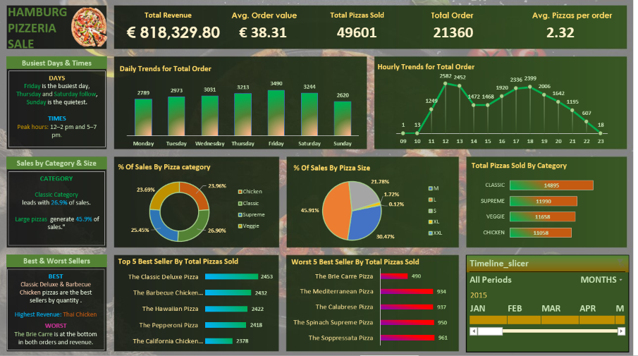

# Hamburg Pizzeria Sales Analysis (SQL and Excel)

Analysis of one year of pizzeria sales data. The data is loaded into PostgreSQL and checked for quality. Fifteen business questions are answered with SQL, and the results are presented in an Excel dashboard.



## Purpose

The project answers the questions a pizzeria owner would ask about sales: when customers order, which products and sizes sell, and where the range could be improved. It also documents the full workflow from raw CSV to dashboard so that every number can be reproduced.

## Key figures

| Revenue | Orders | Pizzas sold | Avg. order value | Pizzas per order |
|---|---|---|---|---|
| € 818,329.80 | 21,360 | 49,601 | € 38.31 | 2.32 |

## Findings

| Question | Result |
|---|---|
| Which day is the busiest? | Friday (3,490 orders). Sunday is the quietest (2,620). |
| When do customers order? | Two peaks: 12:00–14:00 and 17:00–19:00. |
| Which category earns the most? | Classic, with 26.9 % of revenue. |
| Which size sells best? | Large, with 45.9 % of revenue. XL and XXL together are under 2 %. |
| Best sellers by quantity? | The Classic Deluxe Pizza (2,453) and the Barbecue Chicken Pizza (2,432). |
| Best pizza by revenue? | Thai Chicken Pizza (€ 43,434.25). |
| Weakest pizza? | Brie Carre Pizza, lowest in both quantity (490) and revenue. |

## Recommendations

These are based on the sales data only. No cost or margin data was available.

1. Plan staffing around Fridays and the lunch and dinner peaks.
2. Test an offer for Sundays, the weakest day.
3. Review the XL and XXL sizes, which sell very little.
4. Review the Brie Carre pizza: improve it, promote it or replace it.

## Method

1. **Load:** the CSV file is loaded into a PostgreSQL table.
2. **Check data quality:** missing values, orders with conflicting dates or times, weekday against date, and `unit_price × quantity = total_price`. All checks passed.
3. **Analyse:** 15 SQL queries answer the business questions. Each query is documented with its expected result.
4. **Present:** an Excel dashboard shows the KPIs, daily and hourly trends, category and size shares, best and worst sellers, and a time slicer.
5. **Cross-check:** the figures in the dashboard were compared with the SQL results.

### SQL example

```sql
-- Revenue and share of total sales by pizza category
SELECT pizza_category,
       ROUND(SUM(total_price)::NUMERIC, 2) AS total_revenue,
       ROUND((SUM(total_price) / (SELECT SUM(total_price) FROM hamburg_pizzeria_sales) * 100)::NUMERIC, 2) AS pct_contribution
FROM hamburg_pizzeria_sales
GROUP BY pizza_category
ORDER BY pct_contribution DESC;
```

## Project structure

```
hamburg-pizzeria-sales-analysis/
├── data/                              raw CSV file
├── excel/                             Excel dashboard (.xlsx)
├── screenshots/                       dashboard preview images
├── sql/
│   ├── 00_create_table.sql            create table and load CSV
│   ├── 01_data_quality_checks.sql     data validation
│   └── 02_business_queries.sql        the 15 queries behind the dashboard
└── README.md
```

## How to run

1. Create a PostgreSQL database and run `sql/00_create_table.sql`.
2. Load `data/hamburg_pizzeria_sales.csv` (the command is inside the file).
3. Run `sql/01_data_quality_checks.sql`, then `sql/02_business_queries.sql`.
4. Open `excel/Hamburg_Pizza_Sales_Dashboard.xlsx`.

## Tools

PostgreSQL, SQL (aggregation, subqueries, date and time functions), Microsoft Excel (dashboard, slicer)

## Data source and own contribution

**Data:** a public practice dataset for learning SQL and Excel: [Pizza Data For SQL & Excel (Google Drive)](https://drive.google.com/drive/folders/1ecpBALfFUMSK-GOnk-X4nZhC_uK18zih). I found it through the YouTube tutorial "SQL & Excel Portfolio Project" by Swapanjeet S. The data is used here for learning and portfolio purposes only.

**Own work:**

- SQL data quality checks before the analysis
- 15 documented SQL queries with expected results
- Excel dashboard with KPIs, trends, category and size analysis, and a time slicer
- Reconciliation of SQL and Excel figures
- Recommendations based on the findings
- Project structure and documentation

## Limitations

- The data covers a single year, so monthly patterns can be seen but a year-over-year comparison is not possible.
- The dataset is a practice dataset. The findings illustrate the method and do not describe a real business.
- There is no cost or margin data, so the recommendations are based on sales volume and revenue only.

## Author

Dolly · [GitHub](https://github.com/DOLLY3210)
